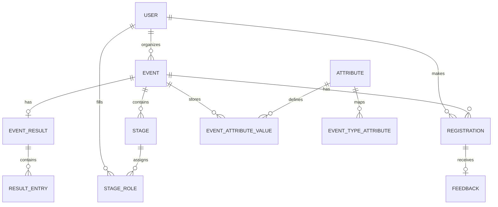

# EVENT-PLANET

EVENT-PLANET is an API-first event planning and management backend. Organizers manage their own events, stages, event attributes, participants, feedback, and results. Participants browse published events, register, and submit feedback after an event is finished. A user interface is not required.

## Features

- Token-based authentication with Participant and Organizer roles. The user model also defines a `SYSTEM` role; public registration currently accepts Participant and Organizer.
- Organizer-owned event management and an enforced event lifecycle:
  `Draft -> Published -> Closed -> Finished`.
- Public event list and detail endpoints expose only Published events.
- Multi-stage event management, with optional stage-role assignments.
- Type-safe dynamic attributes using separate metadata and per-event values. The implementation uses typed database columns, not `JSONField`.
- Event-wide registrations and capacity. Capacity is rechecked in a transaction while locking the event row.
- Feedback restricted to the participant with a confirmed registration, after the event is Finished.
- Organizer-managed results, publicly available only after publication for a Finished event.
- PostgreSQL as the configured database.

## Roles and permissions

| Role | Main capabilities |
| --- | --- |
| Participant | Browse public events, register for Published events, view personal registrations, and submit feedback for eligible registrations. |
| Organizer | Create and manage owned events, stages, custom attributes, attribute values, participant lists, feedback, and results. |
| System | Defined by the user model; it is not an additional public API group. |

Protected endpoints use token authentication:

```http
Authorization: Token <token>
```

Registration and login return a token. Registration accepts the `PARTICIPANT` or `ORGANIZER` role; do not send `SYSTEM`.

## Event lifecycle

New events start as `draft`. The status is changed through the organizer status endpoint, not through the regular event serializer.

| Current status | Allowed next status |
| --- | --- |
| `draft` | `published` |
| `published` | `closed` |
| `closed` | `finished` |
| `finished` | None |

Only Published events appear in public event APIs and accept registrations. Only Draft events can be deleted.

## Stages and registration scope

Stages belong to an event and have their own title, description, order, and start/end times. Organizers can optionally assign users stage roles; suggested role labels include speaker, judge, and coach.

Registration and capacity apply to the **whole event**, not to individual stages. A participant registers once for an event; stage-specific registration and capacity are not implemented.

Public event responses include ordered stage details (`id`, `title`, `description`, `order`, `start_time`, `end_time`). Stage-role usernames are not included in the public event response.

## Dynamic attributes

Attributes are metadata shared across events or scoped to one event. Each event's value is stored separately in `EventAttributeValue`. Supported types are `string`, `integer`, `decimal`, `boolean`, and `date`; values are validated according to their type.

The migration seeds these global attributes and associates them with event types:

| Event type | Attribute | Type |
| --- | --- | --- |
| Webinar | `platform` | string |
| Webinar | `duration_minutes` | integer |
| Webinar | `language` | string |
| Tournament | `competition_type` | string |
| Tournament | `format` | string |
| Tournament | `registration_deadline` | date |
| Workshop | `has_certificate` | boolean |
| Workshop | `skill_level` | string |
| Workshop | `prerequisites` | string |
| Workshop | `duration_hours` | decimal |

These are definitions, not pre-filled event values. Organizers set values for each event. Organizers can also create event-scoped attributes for their own events. Public event responses include attributes with saved values; unset attributes are omitted.

## Feedback and results

- A participant can submit one feedback record for their own confirmed registration, and only after the event is Finished.
- Organizers can view feedback for their own events. Public feedback is available for Finished events and confirmed registrations.
- An event can have one result. Results can be published only after the event is Finished.
- Ranking result entries are restricted to Tournament events. Participation entries require a confirmed participant.
- Public result responses include only published results for Finished events.

## API reference

All paths below are prefixed with `/api/`. Endpoints ending in `{id}` or `{event_id}` expect an integer identifier. Router endpoints use a trailing slash.

### Authentication

| Method | Path | Access | Description |
| --- | --- | --- | --- |
| POST | `/api/auth/register/` | Public | Create an account and receive a token. |
| POST | `/api/auth/login/` | Public | Log in and receive a token. |
| POST | `/api/auth/logout/` | Authenticated | Revoke the current user's token. |
| GET, PUT, PATCH | `/api/auth/me/` | Authenticated | View or update the current user's profile. Role and username are read-only. |

### Events and registrations

| Method | Path | Access | Description |
| --- | --- | --- | --- |
| GET | `/api/public/events/` | Public | List Published events. |
| GET | `/api/public/events/{id}/` | Public | Retrieve a Published event, including saved attributes and ordered stages. |
| GET, POST | `/api/organizer/events/` | Organizer | List owned events or create an event. |
| GET, PUT, PATCH, DELETE | `/api/organizer/events/{id}/` | Owning Organizer | Retrieve or update an owned event; deletion is limited to Draft events. |
| POST | `/api/organizer/events/{id}/status/` | Owning Organizer | Change event status according to the lifecycle. |
| GET, POST | `/api/participant/registrations/` | Participant | List personal registrations or register for an event. |
| GET, PUT, PATCH, DELETE | `/api/participant/registrations/{id}/` | Owning Participant | Retrieve, update, or delete a personal registration. The status field is read-only. |
| GET | `/api/organizer/events/{event_id}/participants/` | Owning Organizer | List registrations for an owned event. |

### Stages

| Method | Path | Access | Description |
| --- | --- | --- | --- |
| GET, POST | `/api/organizer/stages/` | Organizer | List owned stages or create a stage for an owned event. |
| GET, PUT, PATCH, DELETE | `/api/organizer/stages/{id}/` | Owning Organizer | Retrieve, update, or delete an owned stage. |
| GET, POST | `/api/organizer/stage-roles/` | Organizer | List or assign stage roles for owned events. |
| GET, PUT, PATCH, DELETE | `/api/organizer/stage-roles/{id}/` | Owning Organizer | Retrieve, update, or remove a stage-role assignment. |

### Attributes

| Method | Path | Access | Description |
| --- | --- | --- | --- |
| GET | `/api/organizer/attributes/` | Organizer | List global attribute definitions; supports `?event_type=webinar`, `workshop`, or `tournament`. |
| GET | `/api/organizer/event-type-attributes/` | Organizer | List global attribute/type associations; supports `?event_type=...`. |
| GET, POST | `/api/organizer/events/{event_id}/attributes/` | Owning Organizer | List or create event-scoped attributes. |
| GET, PUT, PATCH, DELETE | `/api/organizer/events/{event_id}/attributes/{id}/` | Owning Organizer | Retrieve, update, or delete an event-scoped attribute. |
| GET, POST | `/api/organizer/event-attributes/` | Organizer | List or set event attribute values; supports `?event={id}`. |
| GET, PUT, PATCH, DELETE | `/api/organizer/event-attributes/{id}/` | Owning Organizer | Retrieve, update, or delete an event attribute value. |

Global attribute definitions and their event-type associations are read-only through these APIs; the default definitions are created by a migration.

### Feedback and results

| Method | Path | Access | Description |
| --- | --- | --- | --- |
| GET, POST | `/api/participant/feedback/` | Participant | List personal feedback or submit feedback for an eligible registration. |
| GET, PUT, PATCH, DELETE | `/api/participant/feedback/{id}/` | Owning Participant | Retrieve, update, or delete personal feedback. |
| GET | `/api/organizer/events/{event_id}/feedback/` | Owning Organizer | View feedback for an owned event. |
| GET | `/api/public/events/{event_id}/feedback/` | Public | View public feedback for a Finished event. |
| GET, POST | `/api/organizer/results/` | Organizer | List owned results or create an event result. |
| GET, PUT, PATCH, DELETE | `/api/organizer/results/{id}/` | Owning Organizer | Retrieve, update, or delete an owned result, subject to publication rules. |
| GET, POST | `/api/organizer/result-entries/` | Organizer | List or create entries for owned results; supports `?result={id}`. |
| GET, PUT, PATCH, DELETE | `/api/organizer/result-entries/{id}/` | Owning Organizer | Retrieve, update, or delete an entry. |
| GET | `/api/public/events/{event_id}/results/` | Public | List published results for a Finished event. |

## Example workflow

The following examples use `curl`, a local development server, and placeholder credentials. Replace IDs and tokens with values from the API responses.

### 1. Register an organizer

```bash
curl -X POST http://127.0.0.1:8000/api/auth/register/ \
  -H "Content-Type: application/json" \
  -d '{
    "username": "organizer1",
    "email": "organizer@example.com",
    "password": "replace-this-password",
    "password_confirm": "replace-this-password",
    "role": "ORGANIZER"
  }'
```

Copy the returned token and use it in organizer requests:

```http
Authorization: Token <organizer-token>
```

### 2. Create and publish an event

```bash
curl -X POST http://127.0.0.1:8000/api/organizer/events/ \
  -H "Authorization: Token <organizer-token>" \
  -H "Content-Type: application/json" \
  -d '{
    "title": "Introduction to APIs",
    "description": "A sample workshop",
    "event_type": "workshop",
    "start_time": "2030-05-10T09:00:00Z",
    "end_time": "2030-05-10T12:00:00Z",
    "capacity": 30
  }'
```

Use the returned event ID (shown as `1` below), then publish the event:

```bash
curl -X POST http://127.0.0.1:8000/api/organizer/events/1/status/ \
  -H "Authorization: Token <organizer-token>" \
  -H "Content-Type: application/json" \
  -d '{"status": "published"}'
```

### 3. Add a stage and set an attribute value

```bash
curl -X POST http://127.0.0.1:8000/api/organizer/stages/ \
  -H "Authorization: Token <organizer-token>" \
  -H "Content-Type: application/json" \
  -d '{
    "event": 1,
    "title": "Session 1",
    "description": "API fundamentals",
    "order": 1,
    "start_time": "2030-05-10T09:00:00Z",
    "end_time": "2030-05-10T10:00:00Z"
  }'
```

First retrieve the applicable global attribute ID from
`GET /api/organizer/attributes/?event_type=workshop`. Then set its value (IDs
are examples and should be replaced with actual response IDs):

```bash
curl -X POST http://127.0.0.1:8000/api/organizer/event-attributes/ \
  -H "Authorization: Token <organizer-token>" \
  -H "Content-Type: application/json" \
  -d '{
    "event": 1,
    "attribute": 1,
    "value": "beginner"
  }'
```

To define a custom event attribute, POST to
`/api/organizer/events/1/attributes/` with a name and a supported
`data_type`, then set its value through `/api/organizer/event-attributes/`.
Values must match the attribute type; dates use `YYYY-MM-DD`.

### 4. Register a participant

After the event is Published, authenticate as a Participant and submit:

```bash
curl -X POST http://127.0.0.1:8000/api/participant/registrations/ \
  -H "Authorization: Token <participant-token>" \
  -H "Content-Type: application/json" \
  -d '{"event": 1}'
```

### 5. Finish the event, submit feedback, and publish results

After registrations close, move the event through `closed` and `finished`:

```bash
curl -X POST http://127.0.0.1:8000/api/organizer/events/1/status/ \
  -H "Authorization: Token <organizer-token>" \
  -H "Content-Type: application/json" \
  -d '{"status": "closed"}'

curl -X POST http://127.0.0.1:8000/api/organizer/events/1/status/ \
  -H "Authorization: Token <organizer-token>" \
  -H "Content-Type: application/json" \
  -d '{"status": "finished"}'
```

Use the registration ID returned when the participant registered:

```bash
curl -X POST http://127.0.0.1:8000/api/participant/feedback/ \
  -H "Authorization: Token <participant-token>" \
  -H "Content-Type: application/json" \
  -d '{
    "registration": 1,
    "rating": 5,
    "comment": "Great event"
  }'
```

Create and publish an event result after it is Finished:

```bash
curl -X POST http://127.0.0.1:8000/api/organizer/results/ \
  -H "Authorization: Token <organizer-token>" \
  -H "Content-Type: application/json" \
  -d '{
    "event": 1,
    "summary": "The event has finished.",
    "is_published": true
  }'
```

The public results endpoint is
`GET /api/public/events/1/results/`.

## Data model overview



## Local development

The repository currently has no dependency manifest (`requirements.txt` or `pyproject.toml`). The current development environment reports Django 6.1.2, Django REST Framework 3.18.3, python-decouple 3.8, and psycopg2-binary 2.9.13. These are environment versions, not a locked project dependency specification.

Create and activate a virtual environment, then install the packages:

```bash
python -m venv .venv
# Linux/macOS:
source .venv/bin/activate
# Windows PowerShell:
.\.venv\Scripts\Activate.ps1

python -m pip install Django==6.1.2 djangorestframework==3.18.3 python-decouple==3.8 psycopg2-binary==2.9.13
```

Create a PostgreSQL database and user, then add a root `.env` file:

```dotenv
SECRET_KEY=replace-with-a-long-random-secret
DB_NAME=event_planet
DB_USER=event_planet_user
DB_PASSWORD=replace-with-a-database-password
DB_HOST=localhost
DB_PORT=5432
```

Do not commit real secrets. The development entry point uses
`config.settings.dev` by default. Apply migrations, create an admin user, and
start Django:

```bash
python manage.py migrate
python manage.py createsuperuser
python manage.py runserver
```

The `migrate` command also creates the default event-type attribute definitions.
Run the test suite with:

```bash
python manage.py test
```

Production settings use `config.settings.prod`, require `ALLOWED_HOSTS`, and
accept optional `CSRF_TRUSTED_ORIGINS` as comma-separated values. For example:

```dotenv
ALLOWED_HOSTS=events.example.com
CSRF_TRUSTED_ORIGINS=https://events.example.com
```

## Docker status

No `Dockerfile` or `docker-compose.yml` is currently present in the repository,
so Docker-based startup instructions are not available yet.
